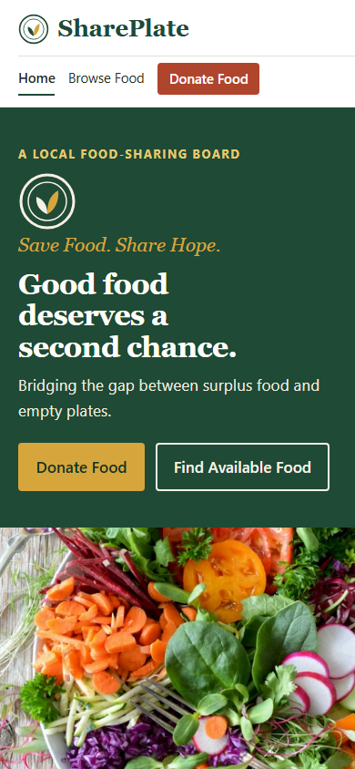
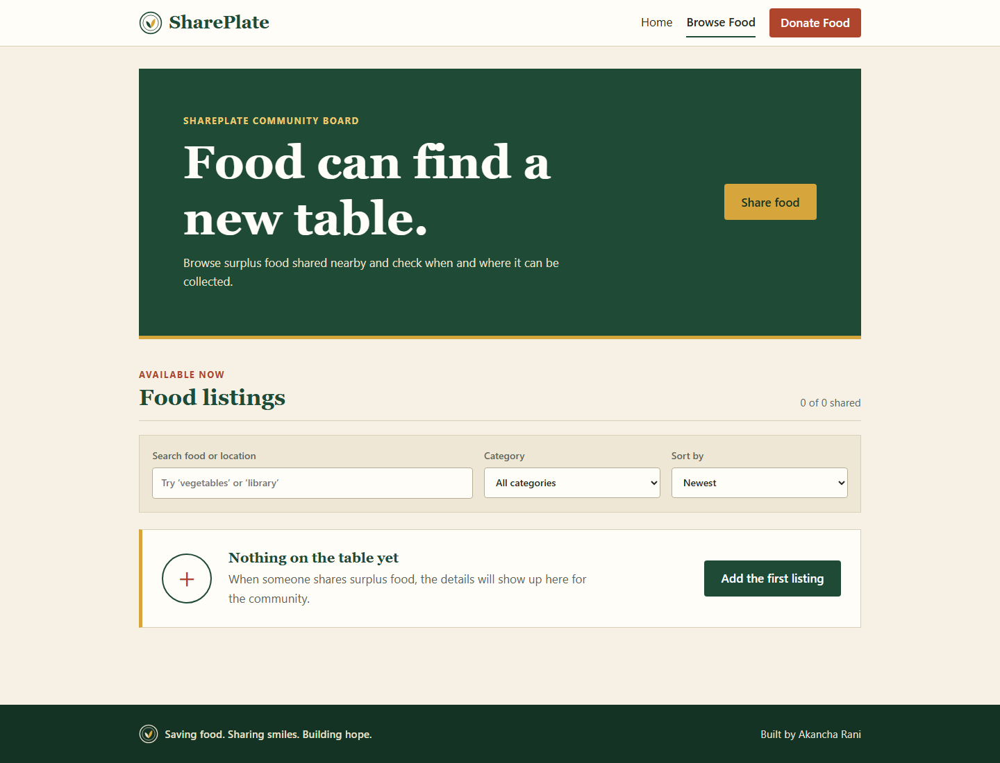
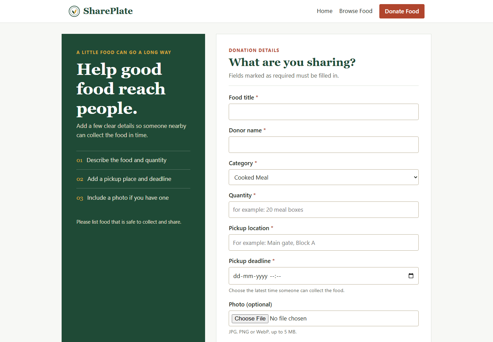

<div align="center">

# SharePlate

### Save Food. Share Hope.

**Good food deserves a second chance.**

A community food rescue app that helps surplus food find a new table.

<br />


<br />

[Explore the project](#-what-is-shareplate) · [Run it locally](#-run-shareplate-locally) · [API routes](#-api-at-a-glance)

</div>

---

## 🍽️ What is SharePlate?

SharePlate is a full-stack food rescue app built around one simple idea: **surplus food should reach people, not the bin.** A donor can list extra food with its quantity, pickup location, deadline and an optional photo. Visitors can browse current listings and find food available for collection.

The app uses a React frontend, an Express REST API and MongoDB for storing donations. Its pages and backend are kept in small, readable parts so the project is straightforward to demonstrate and explain.

## 🌿 What you can do

| Share food | Find food | Manage listings |
| --- | --- | --- |
| Add a donation with pickup details and an optional photo. | Search donations, filter by category and sort by newest or pickup deadline. | Open, edit or delete a donation listing. |

- See a helpful empty state when there are no available donations.
- Get clear feedback when the database is unavailable.
- Use the layout on desktop or mobile.

## 🖥️ A look around

<details>
<summary>See the mobile homepage</summary>
<br />



</details>

<details>
<summary>See Browse Food and Donate Food</summary>
<br />

| Browse Food | Donate Food |
| --- | --- |
|  |  |

</details>

## 🧰 Built with

- **Frontend:** React, Vite, React Router DOM, JavaScript and custom CSS
- **Backend:** Node.js and Express
- **Database:** MongoDB with Mongoose
- **Image upload:** Multer
- **API demonstration:** Postman

## 🚀 Run SharePlate locally

### You’ll need

- Node.js `20.19+`, `22.13+`, or `24+`
- npm
- A running local MongoDB service

### 1. Start the API

Open a PowerShell terminal at the project folder and run:

```powershell
cd server
Copy-Item .env.example .env
npm install
npm start
```

The API starts at `http://localhost:5000`. Keep this terminal open. The example settings connect to local MongoDB at `127.0.0.1:27017` and use the project database `shareplate_ca3`.

If `server/.env` already exists, skip `Copy-Item` so your existing settings stay untouched.

### 2. Start the website

Open a second terminal at the project folder and run:

```powershell
cd client
npm install
npm run dev
```

Open the local address Vite prints in the terminal, usually `http://localhost:5173`.

### 3. Check that it works

- Website: `http://localhost:5173`
- Browse donations: `http://localhost:5173/donations`
- API response: `http://localhost:5000/api/donations`

An empty list is expected until you add your first donation from the website.

## 🔌 API at a glance

| Method | Endpoint | What it does |
| --- | --- | --- |
| `GET` | `/api/donations` | List all donations |
| `GET` | `/api/donations/:id` | View one donation |
| `POST` | `/api/donations` | Create a donation and upload an optional photo |
| `PUT` | `/api/donations/:id` | Update a donation |
| `DELETE` | `/api/donations/:id` | Remove a donation |

Want to try the API in Postman? Import [`docs/SharePlate.postman_collection.json`](docs/SharePlate.postman_collection.json).

## 🗂️ Project map

```text
SharePlate_CA3/
├── client/
│   ├── public/images/       Homepage image and static assets
│   └── src/
│       ├── components/      Navbar, footer, logo and donation card
│       ├── pages/           Home, browse, donation form and not-found pages
│       ├── services/        Frontend API calls
│       └── styles.css       Responsive custom styling
├── server/
│   ├── config/              MongoDB connection
│   ├── controllers/         Donation logic
│   ├── middleware/          Validation, upload, logging and error handling
│   ├── models/              Mongoose donation model
│   ├── routes/              REST endpoints
│   └── uploads/              Uploaded donation photos
└── docs/                    Screenshots and Postman collection
```

## 🔐 Keep database credentials private

Use `server/.env.example` as a local template. Your actual `server/.env` file is ignored by Git and should never be committed or shared. The example file is safe to keep in the repository.

---

<div align="center">

**Less waste. More care. Stronger communities.**

Built to help good food find a new table.

</div>


