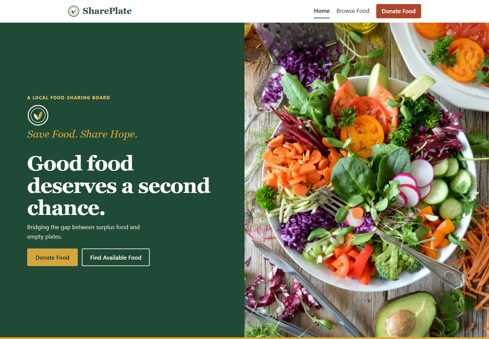
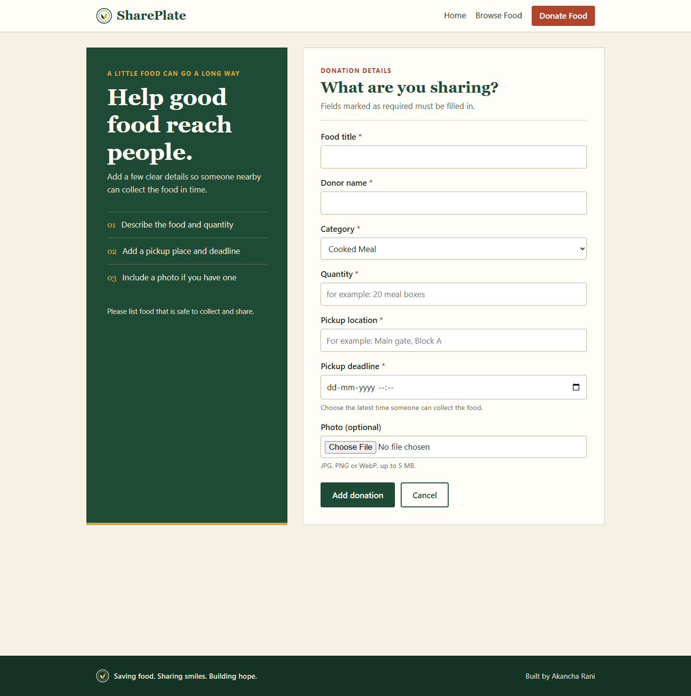

<div align="center">

# SharePlate

### Save Food. Share Hope.

A simple community platform that helps surplus food find the people who can use it.

[Preview the app](docs/screenshots/01-home-desktop.png) · [CA3 guide](CA3_GUIDE.md) · [Project report](docs/CA3_Report.md) · [Postman collection](docs/SharePlate.postman_collection.json)

</div>

---

## About

SharePlate is a full-stack food donation project made for the MCA CO6 CA3 assessment. Donors can post surplus food with pickup details and an optional photo. Visitors can browse, search and filter available donations, then view the details needed to collect them.

The project keeps the main ideas easy to follow: React pages call Express REST endpoints, controllers handle requests, Mongoose stores donations in MongoDB, and Multer handles uploaded photos.

## Screenshots

| Homepage | Browse food |
| --- | --- |
|  |  |

| Donation form | Mobile homepage |
| --- | --- |
|  |  |

## Features

- Responsive homepage with clear donor and receiver actions
- Create a donation with title, donor, category, quantity, pickup location, deadline and optional photo
- Browse donations from MongoDB
- Search by title, donor, quantity or pickup location
- Filter by food category and sort by newest or pickup deadline
- Edit or delete a donation
- Validate required fields and uploaded image type/size
- Show a useful empty state when there are no donations
- Keep database connection errors visible instead of showing sample data

## Technology

- **Frontend:** React, Vite, React Router DOM, JavaScript and custom CSS
- **Backend:** Node.js, Express, Mongoose and Multer
- **Database:** MongoDB
- **API checks:** Postman

## Run locally

### Requirements

- Node.js `20.19+`, `22.13+`, or `24+`
- npm
- A running local MongoDB service

### 1. Configure the server

Open a PowerShell terminal in the project folder and run:

```powershell
cd server
Copy-Item .env.example .env
npm install
npm start
```

The API runs at `http://localhost:5000`. Keep this terminal open. The local settings in `server/.env.example` use MongoDB database `shareplate_ca3` on `127.0.0.1:27017`.

### 2. Start the website

Open a second terminal in the project folder and run:

```powershell
cd client
npm install
npm run dev
```

Open the Vite address shown in the terminal, usually `http://localhost:5173`.

### Check the connection

- Website: `http://localhost:5173`
- Donation listings: `http://localhost:5173/donations`
- Donations API: `http://localhost:5000/api/donations`

The API should return JSON. An empty `data` array is normal before the first donation is added.

## API routes

| Method | Route | Purpose |
| --- | --- | --- |
| `GET` | `/api/donations` | List donations |
| `GET` | `/api/donations/:id` | Get one donation |
| `POST` | `/api/donations` | Create a donation; accepts an optional image |
| `PUT` | `/api/donations/:id` | Update a donation |
| `DELETE` | `/api/donations/:id` | Delete a donation |

To try the requests, import [`docs/SharePlate.postman_collection.json`](docs/SharePlate.postman_collection.json) into Postman.

## Project layout

```text
SharePlate_CA3/
├── client/
│   ├── public/images/       Homepage image and static assets
│   └── src/
│       ├── components/      Navbar, footer, logo and donation card
│       ├── pages/           Home, donations, form and not-found pages
│       ├── services/        API calls used by the frontend
│       └── styles.css       Custom responsive styles
├── server/
│   ├── config/              MongoDB connection
│   ├── controllers/         Donation request logic
│   ├── middleware/          Validation, upload, logging and errors
│   ├── models/              Mongoose donation model
│   ├── routes/              REST API routes
│   └── uploads/              Uploaded donation photos
└── docs/                    Screenshots, report and Postman collection
```

## CA3 concepts demonstrated

- **Routing:** React Router pages and Express donation routes
- **Middleware:** request logging, validation, image upload, database availability and error handling
- **Controllers:** donation CRUD logic kept separate from route definitions
- **REST API:** GET, POST, PUT and DELETE endpoints
- **File upload:** optional donation images handled with Multer

## Useful commands

Run these from the matching folder:

| Folder | Command | Purpose |
| --- | --- | --- |
| `client` | `npm run dev` | Start the frontend |
| `client` | `npm run lint` | Check frontend code style |
| `client` | `npm run build` | Create the frontend production build |
| `server` | `npm start` | Start the API |
| `server` | `npm run dev` | Start the API with Node watch mode |

## Safety note

The real `server/.env` file is local and must not be committed. Keep using `.env.example` as the template; do not put database passwords or private connection strings in GitHub.

---

<div align="center">

**SharePlate — saving food, sharing smiles, building hope.**

</div>
