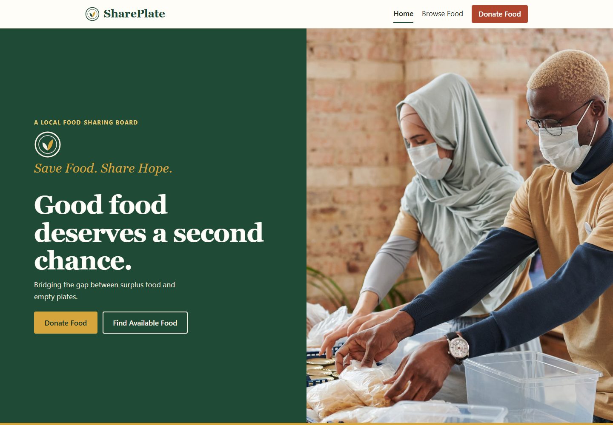
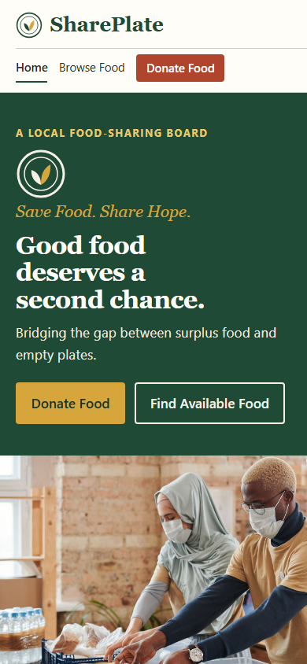
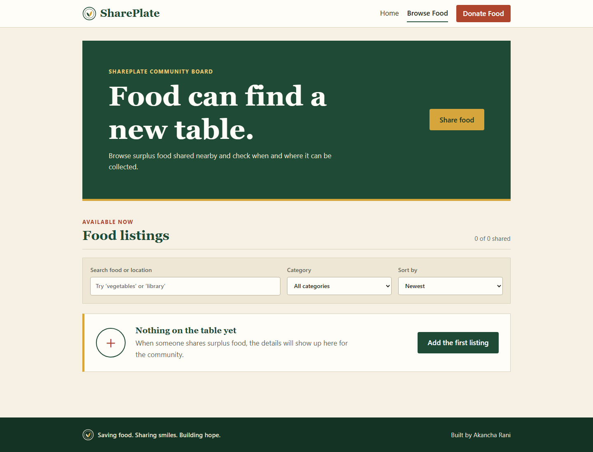
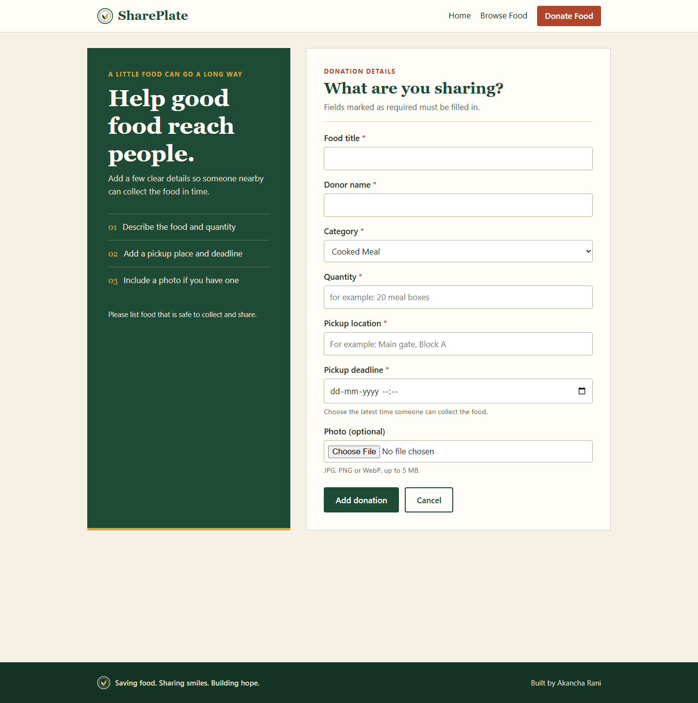
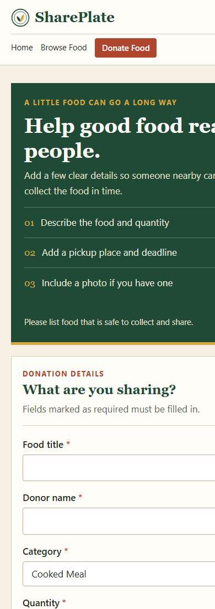
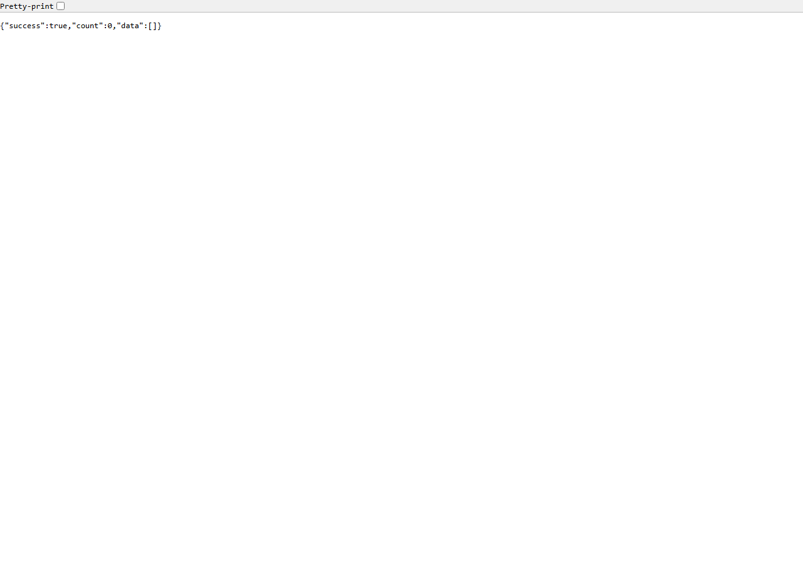

# Front Page

**Project title:** SharePlate — Save Food. Share Hope.

**Assignment:** CA3 — Routing, Middleware, Controller, REST API, File Upload

| | |
|---|---|
| Student name | Akancha Rani |
| Roll number | `<YOUR ROLL NUMBER>` |
| Course | MCA |
| College | `<YOUR COLLEGE>` |
| Faculty | `<FACULTY NAME>` |
| Submission date | `<DATE>` |

---

# 1. Introduction

## 1.1 About the project

SharePlate is a small web application for sharing surplus food. A donor can list food that is left over — what it is, how much there is, where it can be collected and the time by which it must be picked up — and can attach a photo. A visitor can open the Browse Food page and see the listings. Donations can also be edited and deleted.

## 1.2 Objective

The objective is to demonstrate five web-development concepts in one small, working application:

1. Routing
2. Middleware
3. Controller
4. REST API
5. File Upload

## 1.3 Technology used

| Part | Technology |
|---|---|
| Frontend | React, Vite, JavaScript, React Router DOM, custom CSS |
| Backend | Node.js, Express.js |
| Database | MongoDB (local), Mongoose |
| File upload | Multer |
| API testing | Postman |

## 1.4 Scope

The application has three pages (Home, Browse Food, Add/Edit Donation) and a 404 page. It does not include login, user roles, payments or notifications; these are outside the scope of CA3.

---

# 2. Design

## 2.1 Architecture

```
Browser (React, port 5173)
   │  fetch()  JSON or multipart/form-data
   ▼
Express server (port 5000)
   │  requestLogger → cors → express.json → /uploads static → checkDatabase
   ▼
donationRoutes.js  (Express Router)
   │  uploadImage (Multer) → validateDonation
   ▼
donationController.js  (controller functions)
   ▼
Donation.js  (Mongoose model)
   ▼
MongoDB  (database: shareplate_ca3, collection: donations)
```

Request flow: `React form → Express route → middleware → controller → Mongoose model → MongoDB → JSON response → React UI`.

## 2.2 Folder structure

```
SharePlate_CA3/
├── client/src/{App.jsx, pages/, components/, services/, styles.css}
├── server/{server.js, config/, models/, routes/, controllers/, middleware/, uploads/}
└── docs/{CA3_Report.md, SharePlate.postman_collection.json, screenshots/}
```

## 2.3 Frontend routes (React Router, `client/src/App.jsx`)

| Path | Page component | Purpose |
|---|---|---|
| `/` | `Home.jsx` | Introduces SharePlate |
| `/donations` | `Donations.jsx` | Lists donations (GET), delete button |
| `/donations/new` | `DonationForm.jsx` | Add a donation (POST) |
| `/donations/:id/edit` | `DonationForm.jsx` | Edit a donation (GET one, PUT) |
| `*` | `NotFound.jsx` | 404 page |

## 2.4 REST API (Express Router, `server/routes/donationRoutes.js`)

| Method | Endpoint | Middleware | Controller function | Success status |
|---|---|---|---|---|
| GET | `/api/donations` | – | `getAllDonations` | 200 |
| GET | `/api/donations/:id` | – | `getDonationById` | 200 |
| POST | `/api/donations` | `uploadImage`, `validateDonation` | `createDonation` | 201 |
| PUT | `/api/donations/:id` | `validateDonation` | `updateDonation` | 200 |
| DELETE | `/api/donations/:id` | – | `deleteDonation` | 200 |

All responses are JSON: `{ "success": true, "message": "...", "data": ... }` or `{ "success": false, "message": "..." }`. Other status codes used: 400 (invalid data or file), 404 (not found), 503 (database not connected).

## 2.5 Database design (`server/models/Donation.js`)

Database `shareplate_ca3`, collection `donations`.

| Field | Type | Notes |
|---|---|---|
| `title` | String | required |
| `donorName` | String | required |
| `category` | String | one of: Cooked Meal, Fresh Produce, Packaged Food, Bakery, Other |
| `quantity` | String | required, for example "20 meal boxes" |
| `pickupLocation` | String | required |
| `pickupDeadline` | Date | required |
| `imageFilename` | String | generated file name only, empty if no photo |
| `createdAt`, `updatedAt` | Date | added automatically by Mongoose |

## 2.6 Middleware design and order (`server/server.js`)

1. `requestLogger` — prints method, URL, status and time of every request.
2. `cors` — allows the React app on another port to call the API.
3. `express.json()` — reads JSON bodies.
4. `/uploads` static route — serves saved images.
5. `checkDatabase` — returns 503 with a clear message if MongoDB is not connected.
6. Route middleware for POST: `uploadImage` (Multer) → `validateDonation`.
7. `notFound` — 404 JSON for unknown routes.
8. `errorHandler` — last; turns any error into a JSON response.

## 2.7 File upload design (`server/middleware/upload.js`)

- One optional image, form field name `image`.
- Allowed: JPG, JPEG, PNG, WebP. Maximum size: 5 MB.
- Saved name is `crypto.randomUUID()` plus an extension chosen by the server, so the user's file name or path is never used.
- Files are saved in `server/uploads` and served at `/uploads/<filename>`.
- Only the file name is stored in MongoDB.

## 2.8 User interface design

Near-white background, deep forest green for the hero and final call to action, harvest gold for the tagline and accents, and muted tomato for small emphasis. The homepage uses the locally stored fresh food photograph restored from the earlier SharePlate homepage preview. “Save Food. Share Hope.” leads into the main message, “Good food deserves a second chance,” with two clear actions. A short quote band, a three-step process, three community benefits and a final donation call to action build a social-impact tone without invented statistics or sample listings. The footer tagline is “Saving food. Sharing smiles. Building hope.” Georgia is used for headings and Segoe UI for body text. The layout is responsive for phones and desktops.

**Photo note:** `client/public/images/hero.jpg` contains the fresh food photograph restored from the earlier SharePlate homepage preview.

---

# 3. Code

This section lists the main project files exactly as they appear in the project.

## 3.1 Routing

**`client/src/App.jsx`**

```jsx
// App.jsx
// ROUTING (frontend) - React Router.
// All page routes of the website are listed here in one place.
import { Routes, Route } from 'react-router-dom';
import Navbar from './components/Navbar.jsx';
import Footer from './components/Footer.jsx';
import Home from './pages/Home.jsx';
import Donations from './pages/Donations.jsx';
import DonationForm from './pages/DonationForm.jsx';
import NotFound from './pages/NotFound.jsx';

function App() {
  return (
    <>
      <Navbar />
      <main>
        <Routes>
          <Route path="/" element={<Home />} />
          <Route path="/donations" element={<Donations />} />
          {/* The same form page is used for adding and for editing */}
          <Route path="/donations/new" element={<DonationForm />} />
          <Route path="/donations/:id/edit" element={<DonationForm />} />
          {/* "*" matches any other address = 404 page */}
          <Route path="*" element={<NotFound />} />
        </Routes>
      </main>
      <Footer />
    </>
  );
}

export default App;
```


**`server/routes/donationRoutes.js`**

```javascript
// routes/donationRoutes.js
// ROUTING (backend) - Express Router.
// This file only maps  METHOD + URL  ->  middleware  ->  controller function.
// It is mounted at /api/donations in server.js, so "/" here means /api/donations.
const express = require('express');
const router = express.Router();

const {
  getAllDonations,
  getDonationById,
  createDonation,
  updateDonation,
  deleteDonation,
} = require('../controllers/donationController');
const { uploadImage } = require('../middleware/upload');
const validateDonation = require('../middleware/validateDonation');

router.get('/', getAllDonations); //            GET    /api/donations
router.get('/:id', getDonationById); //         GET    /api/donations/:id
router.post('/', uploadImage, validateDonation, createDonation); // POST   (Multer first, then validation, then controller)
router.put('/:id', validateDonation, updateDonation); //          PUT    /api/donations/:id
router.delete('/:id', deleteDonation); //       DELETE /api/donations/:id

module.exports = router;
```


## 3.2 Middleware

**`server/middleware/requestLogger.js`**

```javascript
// middleware/requestLogger.js
// MIDDLEWARE 1 - Logging.
// Runs for every request. It waits until the response is finished,
// then prints:  METHOD  URL  STATUS  time taken.
function requestLogger(req, res, next) {
  const startTime = Date.now();

  res.on('finish', () => {
    const timeTaken = Date.now() - startTime;
    console.log(req.method + ' ' + req.originalUrl + ' -> ' + res.statusCode + ' (' + timeTaken + 'ms)');
  });

  next(); // pass control to the next middleware
}

module.exports = requestLogger;
```


**`server/middleware/validateDonation.js`**

```javascript
// middleware/validateDonation.js
// MIDDLEWARE 2 - Validation.
// Checks the required fields BEFORE the controller runs.
// For POST this runs after Multer, because Multer is what fills req.body for multipart forms.
const { CATEGORIES } = require('../models/Donation');
const { deleteUploadedFile } = require('./upload');

const REQUIRED_FIELDS = ['title', 'donorName', 'category', 'quantity', 'pickupLocation', 'pickupDeadline'];

function validateDonation(req, res, next) {
  const errors = [];

  // 1. Every required field must be present and not just spaces.
  for (const field of REQUIRED_FIELDS) {
    const value = req.body[field];
    if (value === undefined || String(value).trim() === '') {
      errors.push(field + ' is required');
    }
  }

  // 2. Category must be one of the allowed values.
  if (req.body.category && !CATEGORIES.includes(req.body.category)) {
    errors.push('category must be one of: ' + CATEGORIES.join(', '));
  }

  // 3. Pickup deadline must be a real date.
  if (req.body.pickupDeadline && isNaN(new Date(req.body.pickupDeadline).getTime())) {
    errors.push('pickupDeadline must be a valid date');
  }

  if (errors.length > 0) {
    // The image was already saved by Multer, so remove it. Otherwise it would be left behind.
    if (req.file) {
      deleteUploadedFile(req.file.filename);
    }
    return res.status(400).json({ success: false, message: 'Please fix the form errors.', errors: errors });
  }

  next();
}

module.exports = validateDonation;
```


**`server/middleware/upload.js`**

```javascript
// middleware/upload.js
// MIDDLEWARE 3 - File upload using Multer.
// Accepts ONE optional image in the form field named "image".
const multer = require('multer');
const path = require('path');
const fs = require('fs');
const crypto = require('crypto');

const UPLOAD_FOLDER = path.join(__dirname, '..', 'uploads');
const MAX_FILE_SIZE = 5 * 1024 * 1024; // 5 MB

// Allowed types. The file extension we save comes from THIS table,
// not from the name the user sent, so the user cannot choose the saved name or path.
const ALLOWED_TYPES = {
  'image/jpeg': '.jpg',
  'image/png': '.png',
  'image/webp': '.webp',
};
const ALLOWED_EXTENSIONS = ['.jpg', '.jpeg', '.png', '.webp'];

// Where and how to save the file.
const storage = multer.diskStorage({
  destination: (req, file, callback) => {
    callback(null, UPLOAD_FOLDER);
  },
  filename: (req, file, callback) => {
    // Safe unique name: random id + extension chosen by us.
    const uniqueName = crypto.randomUUID() + ALLOWED_TYPES[file.mimetype];
    callback(null, uniqueName);
  },
});

// Decide whether a file is allowed. Called before the file is saved.
function fileFilter(req, file, callback) {
  const extension = path.extname(file.originalname).toLowerCase();
  const typeIsAllowed = ALLOWED_TYPES[file.mimetype] !== undefined;
  const extensionIsAllowed = ALLOWED_EXTENSIONS.includes(extension);

  if (typeIsAllowed && extensionIsAllowed) {
    callback(null, true);
  } else {
    const error = new Error('Unsupported file type. Please upload a JPG, JPEG, PNG or WebP image.');
    error.statusCode = 400;
    callback(error); // goes to the central error handler
  }
}

// upload.single("image") = accept one file from the field called "image".
const uploadImage = multer({
  storage: storage,
  fileFilter: fileFilter,
  limits: { fileSize: MAX_FILE_SIZE },
}).single('image');

// Helper: delete a saved image. path.basename() removes any folder parts,
// so only a file inside the uploads folder can ever be deleted.
function deleteUploadedFile(filename) {
  if (!filename) return;
  const safeName = path.basename(filename);
  fs.unlink(path.join(UPLOAD_FOLDER, safeName), () => {
    // If the file is already gone, we simply ignore the error.
  });
}

module.exports = { uploadImage, deleteUploadedFile, UPLOAD_FOLDER };
```


**`server/middleware/errorHandler.js`**

```javascript
// middleware/errorHandler.js
// MIDDLEWARE 4 - Central error handling.
// Express knows this is an error handler because it has FOUR parameters (err, req, res, next).
// Any error passed with next(error), or thrown by Multer, ends up here.
const multer = require('multer');

// Runs when no route matched (placed after all routes).
function notFound(req, res) {
  res.status(404).json({ success: false, message: 'Route not found: ' + req.method + ' ' + req.originalUrl });
}

function errorHandler(err, req, res, next) {
  let statusCode = err.statusCode || 500;
  let message = err.message || 'Something went wrong on the server.';

  // Multer errors (for example: file too large)
  if (err instanceof multer.MulterError) {
    statusCode = 400;
    if (err.code === 'LIMIT_FILE_SIZE') {
      message = 'Image is too large. The maximum size is 5 MB.';
    } else if (err.code === 'LIMIT_UNEXPECTED_FILE') {
      message = 'Upload only one image, using the field name "image".';
    }
  }

  // Mongoose: an id like "abc" is not a valid MongoDB id
  if (err.name === 'CastError') {
    statusCode = 400;
    message = 'Invalid donation id.';
  }

  // Mongoose: data did not match the schema
  if (err.name === 'ValidationError') {
    statusCode = 400;
  }

  if (statusCode === 500) {
    console.error('[ERROR]', err);
    message = 'Something went wrong on the server.'; // do not leak details to the browser
  }

  res.status(statusCode).json({ success: false, message: message });
}

module.exports = { notFound, errorHandler };
```


**`server/middleware/checkDatabase.js`**

```javascript
// middleware/checkDatabase.js
// Stops the request early with a clear message if MongoDB is not connected.
// (We never fall back to mock data or another database.)
const mongoose = require('mongoose');

function checkDatabase(req, res, next) {
  const isConnected = mongoose.connection.readyState === 1; // 1 means "connected"

  if (!isConnected) {
    return res.status(503).json({
      success: false,
      message:
        'Database is not connected. Make sure the local MongoDB service is running, then restart the SharePlate server.',
    });
  }

  next();
}

module.exports = checkDatabase;
```


## 3.3 Controller

**`server/controllers/donationController.js`**

```javascript
// controllers/donationController.js
// CONTROLLER - the functions that do the real work with the database.
// The route file only decides WHICH function runs. These functions decide WHAT happens.
// Every function: talk to the model -> send a JSON response. Errors go to next(error).
const Donation = require('../models/Donation');
const { deleteUploadedFile } = require('../middleware/upload');

// Take only the fields we allow from req.body (ignores anything extra).
function pickDonationFields(body) {
  return {
    title: body.title,
    donorName: body.donorName,
    category: body.category,
    quantity: body.quantity,
    pickupLocation: body.pickupLocation,
    pickupDeadline: body.pickupDeadline,
  };
}

// GET /api/donations  - list all donations, newest first
async function getAllDonations(req, res, next) {
  try {
    const donations = await Donation.find().sort({ createdAt: -1 });
    res.status(200).json({ success: true, count: donations.length, data: donations });
  } catch (error) {
    next(error);
  }
}

// GET /api/donations/:id  - one donation
async function getDonationById(req, res, next) {
  try {
    const donation = await Donation.findById(req.params.id);
    if (!donation) {
      return res.status(404).json({ success: false, message: 'Donation not found.' });
    }
    res.status(200).json({ success: true, data: donation });
  } catch (error) {
    next(error);
  }
}

// POST /api/donations  - create a donation (multipart/form-data, optional "image")
async function createDonation(req, res, next) {
  try {
    const donationData = pickDonationFields(req.body);

    // req.file exists only if Multer saved an image. We keep just its generated name.
    if (req.file) {
      donationData.imageFilename = req.file.filename;
    }

    const newDonation = await Donation.create(donationData);
    res.status(201).json({ success: true, message: 'Donation added.', data: newDonation });
  } catch (error) {
    // Saving failed, so do not leave an orphan image on disk.
    if (req.file) {
      deleteUploadedFile(req.file.filename);
    }
    next(error);
  }
}

// PUT /api/donations/:id  - update the text fields (JSON body)
async function updateDonation(req, res, next) {
  try {
    const updatedDonation = await Donation.findByIdAndUpdate(req.params.id, pickDonationFields(req.body), {
      new: true, // return the updated record
      runValidators: true, // apply schema rules to the update too
    });
    if (!updatedDonation) {
      return res.status(404).json({ success: false, message: 'Donation not found.' });
    }
    res.status(200).json({ success: true, message: 'Donation updated.', data: updatedDonation });
  } catch (error) {
    next(error);
  }
}

// DELETE /api/donations/:id  - remove the record and its image file
async function deleteDonation(req, res, next) {
  try {
    const deletedDonation = await Donation.findByIdAndDelete(req.params.id);
    if (!deletedDonation) {
      return res.status(404).json({ success: false, message: 'Donation not found.' });
    }
    deleteUploadedFile(deletedDonation.imageFilename);
    res.status(200).json({ success: true, message: 'Donation deleted.' });
  } catch (error) {
    next(error);
  }
}

module.exports = { getAllDonations, getDonationById, createDonation, updateDonation, deleteDonation };
```


## 3.4 Model and database connection

**`server/models/Donation.js`**

```javascript
// models/Donation.js
// The Mongoose model: describes what one donation looks like in MongoDB.
const mongoose = require('mongoose');

// The only categories the app accepts (also used by the validation middleware).
const CATEGORIES = ['Cooked Meal', 'Fresh Produce', 'Packaged Food', 'Bakery', 'Other'];

const donationSchema = new mongoose.Schema(
  {
    title: { type: String, required: true, trim: true },
    donorName: { type: String, required: true, trim: true },
    category: { type: String, required: true, enum: CATEGORIES },
    quantity: { type: String, required: true, trim: true }, // example: "20 meal boxes"
    pickupLocation: { type: String, required: true, trim: true },
    pickupDeadline: { type: Date, required: true },
    // We store ONLY the generated file name (for example "a1b2.jpg"), never a full path.
    imageFilename: { type: String, default: '' },
  },
  { timestamps: true } // Mongoose adds createdAt and updatedAt for us
);

const Donation = mongoose.model('Donation', donationSchema);

module.exports = Donation;
module.exports.CATEGORIES = CATEGORIES;
```


**`server/config/db.js`**

```javascript
// config/db.js
// Connects Mongoose to the LOCAL MongoDB that is already running on this computer.
// This project only ever uses the "shareplate_ca3" database.
const mongoose = require('mongoose');

async function connectDB() {
  const uri = process.env.MONGODB_URI;

  if (!uri) {
    console.error('[DB] MONGODB_URI is missing. Copy server/.env.example to server/.env first.');
    return false;
  }

  // Safety check: refuse to touch the old CA2 database called "shareplate".
  const databaseName = new URL(uri).pathname.replace('/', '');
  if (databaseName === 'shareplate') {
    console.error('[DB] Refusing to connect to the old "shareplate" database. Use shareplate_ca3.');
    return false;
  }

  try {
    await mongoose.connect(uri, { serverSelectionTimeoutMS: 4000 });
    console.log('[DB] MongoDB connected. Database: ' + mongoose.connection.name);
    return true;
  } catch (error) {
    console.error('[DB] Could not connect to MongoDB at ' + uri);
    console.error('[DB] Open Windows "Services" and check that the "MongoDB Server" service is Running,');
    console.error('[DB] then restart this server. The app will not use mock data or another database.');
    return false;
  }
}

module.exports = connectDB;
```


## 3.5 Server setup (middleware order)

**`server/server.js`**

```javascript
// server.js - starts the Express app.
//
// ORDER OF MIDDLEWARE (Express runs them top to bottom for every request):
//   1. requestLogger        - logs the request
//   2. cors                 - lets the React app (another port) call this API
//   3. express.json         - reads JSON request bodies
//   4. /uploads static      - serves saved images
//   5. checkDatabase        - stops early if MongoDB is down (API routes only)
//   6. donationRoutes       - route-level middleware: Multer -> validation -> controller
//   7. notFound             - no route matched -> 404 JSON
//   8. errorHandler         - LAST: catches every error passed with next(error)
require('dotenv').config();
const express = require('express');
const cors = require('cors');
const path = require('path');

const connectDB = require('./config/db');
const requestLogger = require('./middleware/requestLogger');
const checkDatabase = require('./middleware/checkDatabase');
const { notFound, errorHandler } = require('./middleware/errorHandler');
const donationRoutes = require('./routes/donationRoutes');

const app = express();
const PORT = process.env.PORT || 5000;
const CLIENT_URL = process.env.CLIENT_URL || 'http://localhost:5173';

app.use(requestLogger);
// Allowed browser addresses. localhost and 127.0.0.1 are different "origins" for the browser,
// so both are listed, plus the CLIENT_URL from .env.
const allowedOrigins = [CLIENT_URL, 'http://localhost:5173', 'http://127.0.0.1:5173'];
app.use(cors({ origin: allowedOrigins }));
app.use(express.json());

// Static route: http://localhost:5000/uploads/<filename> shows a saved image.
app.use('/uploads', express.static(path.join(__dirname, 'uploads')));

// Donation API (Express Router mounted at /api/donations)
app.use('/api/donations', checkDatabase, donationRoutes);

app.use(notFound);
app.use(errorHandler);

// Start the server first, then try the database, so the setup message is clear either way.
app.listen(PORT, () => {
  console.log('SharePlate server running at http://localhost:' + PORT);
  connectDB();
});
```


## 3.6 Frontend: API service, pages and components

**`client/src/services/donationApi.js`**

```javascript
// services/donationApi.js
// All calls from React to the Express REST API are kept in this one file.
const API_URL = import.meta.env.VITE_API_URL || 'http://localhost:5000';

// Full web address of an uploaded image (served by Express at /uploads).
export function getImageUrl(imageFilename) {
  return API_URL + '/uploads/' + imageFilename;
}

// Sends the request, reads the JSON reply, and throws a readable error if something failed.
async function sendRequest(path, options) {
  let response;
  try {
    response = await fetch(API_URL + '/api/donations' + path, options);
  } catch {
    throw new Error('Cannot reach the SharePlate server. Start it with "npm start" in the server folder.');
  }

  const result = await response.json();

  if (!response.ok) {
    // result.errors holds the list from the validation middleware
    const details = result.errors ? ' ' + result.errors.join('. ') + '.' : '';
    throw new Error(result.message + details);
  }
  return result;
}

// GET /api/donations
export function getDonations() {
  return sendRequest('', { method: 'GET' });
}

// GET /api/donations/:id
export function getDonation(id) {
  return sendRequest('/' + id, { method: 'GET' });
}

// POST /api/donations  (formData because the request can contain an image file)
// Do not set Content-Type here: the browser adds it, including the multipart boundary.
export function createDonation(formData) {
  return sendRequest('', { method: 'POST', body: formData });
}

// PUT /api/donations/:id  (plain JSON)
export function updateDonation(id, donationData) {
  return sendRequest('/' + id, {
    method: 'PUT',
    headers: { 'Content-Type': 'application/json' },
    body: JSON.stringify(donationData),
  });
}

// DELETE /api/donations/:id
export function deleteDonation(id) {
  return sendRequest('/' + id, { method: 'DELETE' });
}
```


**`client/src/pages/Donations.jsx`**

```jsx
import { useEffect, useState } from 'react';
import { Link, useLocation } from 'react-router-dom';
import DonationCard from '../components/DonationCard.jsx';
import { getDonations, deleteDonation } from '../services/donationApi.js';

function Donations() {
  const location = useLocation();
  const [donations, setDonations] = useState([]);
  const [isLoading, setIsLoading] = useState(true);
  const [errorMessage, setErrorMessage] = useState('');
  const [searchText, setSearchText] = useState('');
  const [categoryFilter, setCategoryFilter] = useState('All categories');
  const [sortBy, setSortBy] = useState('newest');

  const categories = ['Cooked Meal', 'Fresh Produce', 'Packaged Food', 'Bakery', 'Other'];
  const visibleDonations = donations
    .filter((donation) => {
      const searchValue = [donation.title, donation.quantity, donation.pickupLocation, donation.donorName]
        .join(' ')
        .toLowerCase();
      const matchesText = searchValue.includes(searchText.trim().toLowerCase());
      const matchesCategory = categoryFilter === 'All categories' || donation.category === categoryFilter;
      return matchesText && matchesCategory;
    })
    .sort((first, second) => {
      if (sortBy === 'deadline') {
        return new Date(first.pickupDeadline) - new Date(second.pickupDeadline);
      }
      return new Date(second.createdAt) - new Date(first.createdAt);
    });

  // Runs once when the page opens: GET /api/donations
  useEffect(() => {
    async function loadDonations() {
      try {
        const result = await getDonations();
        setDonations(result.data);
      } catch (error) {
        setErrorMessage(error.message);
      } finally {
        setIsLoading(false);
      }
    }
    loadDonations();
  }, []);

  // DELETE /api/donations/:id, then remove the card from the screen
  async function handleDelete(donation) {
    const confirmed = window.confirm('Delete "' + donation.title + '"? This cannot be undone.');
    if (!confirmed) return;

    try {
      await deleteDonation(donation._id);
      setDonations(donations.filter((item) => item._id !== donation._id));
    } catch (error) {
      setErrorMessage(error.message);
    }
  }

  return (
    <section className="section browse-page">
      <div className="container">
        <div className="browse-banner">
          <div>
            <p className="section-kicker">SharePlate community board</p>
            <h1>Food can find a new table.</h1>
            <p>Browse surplus food shared nearby and check when and where it can be collected.</p>
          </div>
          <Link to="/donations/new" className="button button-accent">
            Share food
          </Link>
        </div>

        {location.state?.notice && (
          <p className="message message-success" role="status">{location.state.notice}</p>
        )}

        <div className="listing-heading">
          <div>
            <p className="section-kicker">Available now</p>
            <h2>Food listings</h2>
          </div>
          {!isLoading && !errorMessage && (
            <span className="listing-count">{visibleDonations.length} of {donations.length} shared</span>
          )}
        </div>

        {!isLoading && !errorMessage && (
          <div className="listing-tools" aria-label="Filter food listings">
            <label className="search-control">
              <span>Search food or location</span>
              <input
                type="search"
                value={searchText}
                onChange={(event) => setSearchText(event.target.value)}
                placeholder="Try ‘vegetables’ or ‘library’"
              />
            </label>
            <label>
              <span>Category</span>
              <select value={categoryFilter} onChange={(event) => setCategoryFilter(event.target.value)}>
                <option>All categories</option>
                {categories.map((category) => <option key={category}>{category}</option>)}
              </select>
            </label>
            <label>
              <span>Sort by</span>
              <select value={sortBy} onChange={(event) => setSortBy(event.target.value)}>
                <option value="newest">Newest</option>
                <option value="deadline">Pickup deadline</option>
              </select>
            </label>
          </div>
        )}

        {isLoading && <p>Loading donations...</p>}

        {errorMessage && (
          <p className="message message-error" role="alert">
            {errorMessage}
          </p>
        )}

        {!isLoading && !errorMessage && donations.length === 0 && (
          <div className="browse-empty">
            <div className="empty-plate" aria-hidden="true"><span>+</span></div>
            <div className="browse-empty-copy">
              <h3>Nothing on the table yet</h3>
              <p>When someone shares surplus food, the details will show up here for the community.</p>
            </div>
            <Link to="/donations/new" className="button button-primary">
              Add the first listing
            </Link>
          </div>
        )}

        {!isLoading && !errorMessage && donations.length > 0 && visibleDonations.length === 0 && (
          <div className="browse-empty browse-empty-filtered">
            <div className="browse-empty-copy">
              <h3>No matching food found</h3>
              <p>Try another search or choose a different category.</p>
            </div>
          </div>
        )}

        <div className="donation-grid">
          {visibleDonations.map((donation) => (
            <DonationCard key={donation._id} donation={donation} onDelete={handleDelete} />
          ))}
        </div>
      </div>
    </section>
  );
}

export default Donations;
```


**`client/src/pages/DonationForm.jsx`**

```jsx
import { useEffect, useState } from 'react';
import { useNavigate, useParams, Link } from 'react-router-dom';
import { getDonation, createDonation, updateDonation, getImageUrl } from '../services/donationApi.js';

const CATEGORIES = ['Cooked Meal', 'Fresh Produce', 'Packaged Food', 'Bakery', 'Other'];

const EMPTY_FORM = {
  title: '',
  donorName: '',
  category: 'Cooked Meal',
  quantity: '',
  pickupLocation: '',
  pickupDeadline: '',
};

// An ISO date from the database -> the "2026-11-05T18:30" text a datetime-local input needs.
function toInputValue(isoDate) {
  const date = new Date(isoDate);
  const localTime = new Date(date.getTime() - date.getTimezoneOffset() * 60000);
  return localTime.toISOString().slice(0, 16);
}

// One page used for both: Add (POST) and Edit (PUT).
function DonationForm() {
  const { id } = useParams(); // id exists only on /donations/:id/edit
  const isEditing = Boolean(id);
  const navigate = useNavigate();

  const [formData, setFormData] = useState(EMPTY_FORM);
  const [imageFile, setImageFile] = useState(null);
  const [imagePreviewUrl, setImagePreviewUrl] = useState('');
  const [currentImage, setCurrentImage] = useState('');
  const [isLoading, setIsLoading] = useState(isEditing);
  const [isSaving, setIsSaving] = useState(false);
  const [errorMessage, setErrorMessage] = useState('');

  useEffect(() => {
    if (!imageFile) {
      return undefined;
    }
    const reader = new FileReader();
    reader.onload = () => setImagePreviewUrl(reader.result);
    reader.readAsDataURL(imageFile);
    return () => reader.abort();
  }, [imageFile]);

  // Edit mode: load the existing donation (GET /api/donations/:id) to fill the form.
  useEffect(() => {
    if (!id) return;
    async function loadDonation() {
      try {
        const result = await getDonation(id);
        const donation = result.data;
        setFormData({
          title: donation.title,
          donorName: donation.donorName,
          category: donation.category,
          quantity: donation.quantity,
          pickupLocation: donation.pickupLocation,
          pickupDeadline: toInputValue(donation.pickupDeadline),
        });
        setCurrentImage(donation.imageFilename);
      } catch (error) {
        setErrorMessage(error.message);
      } finally {
        setIsLoading(false);
      }
    }
    loadDonation();
  }, [id]);

  // Update one field in formData whenever the user types.
  function handleChange(event) {
    setFormData({ ...formData, [event.target.name]: event.target.value });
  }

  async function handleSubmit(event) {
    event.preventDefault(); // stop the browser from reloading the page
    setErrorMessage('');
    setIsSaving(true);

    // The browser's local time is converted to a standard date string for the API.
    const deadlineIso = formData.pickupDeadline ? new Date(formData.pickupDeadline).toISOString() : '';

    try {
      if (isEditing) {
        // PUT sends JSON
        await updateDonation(id, { ...formData, pickupDeadline: deadlineIso });
      } else {
        // POST sends multipart/form-data so the image file can travel with the text
        const body = new FormData();
        body.append('title', formData.title);
        body.append('donorName', formData.donorName);
        body.append('category', formData.category);
        body.append('quantity', formData.quantity);
        body.append('pickupLocation', formData.pickupLocation);
        body.append('pickupDeadline', deadlineIso);
        if (imageFile) {
          body.append('image', imageFile); // field name must be "image"
        }
        await createDonation(body);
      }
      navigate('/donations', {
        state: { notice: isEditing ? 'Your donation listing has been updated.' : 'Your food donation has been added.' },
      }); // return to the list, where the saved data is shown
    } catch (error) {
      setErrorMessage(error.message);
      setIsSaving(false);
    }
  }

  if (isLoading) {
    return (
      <section className="section">
        <div className="container form-container">
          <p>Loading donation...</p>
        </div>
      </section>
    );
  }

  return (
    <section className="section donate-page">
      <div className="container donation-form-layout">
        <aside className="donate-intro">
          <p className="section-kicker">A little food can go a long way</p>
          <h1>{isEditing ? 'Update your listing.' : 'Help good food reach people.'}</h1>
          <p className="donate-intro-copy">
            {isEditing
              ? 'Keep the pickup information current so people know what to expect.'
              : 'Add a few clear details so someone nearby can collect the food in time.'}
          </p>
          <div className="donate-guidance">
            <p><span>01</span> Describe the food and quantity</p>
            <p><span>02</span> Add a pickup place and deadline</p>
            <p><span>03</span> Include a photo if you have one</p>
          </div>
          <p className="donate-aside-note">Please list food that is safe to collect and share.</p>
        </aside>

        <div className="form-panel">
          <div className="form-panel-heading">
            <p className="section-kicker">Donation details</p>
            <h2>{isEditing ? 'Edit the details' : 'What are you sharing?'}</h2>
            <p>{isEditing ? 'Make your changes, then save the listing.' : 'Fields marked as required must be filled in.'}</p>
          </div>

          {errorMessage && (
            <p className="message message-error" role="alert">
              {errorMessage}
            </p>
          )}

          <form onSubmit={handleSubmit} className="donation-form">
          <label htmlFor="title">Food title <span className="required-mark">*</span></label>
          <input id="title" name="title" type="text" value={formData.title} onChange={handleChange} required />

          <label htmlFor="donorName">Donor name <span className="required-mark">*</span></label>
          <input
            id="donorName"
            name="donorName"
            type="text"
            value={formData.donorName}
            onChange={handleChange}
            required
          />

          <label htmlFor="category">Category <span className="required-mark">*</span></label>
          <select id="category" name="category" value={formData.category} onChange={handleChange} required>
            {CATEGORIES.map((category) => (
              <option key={category} value={category}>
                {category}
              </option>
            ))}
          </select>

          <label htmlFor="quantity">Quantity <span className="required-mark">*</span></label>
          <input
            id="quantity"
            name="quantity"
            type="text"
            placeholder="for example: 20 meal boxes"
            value={formData.quantity}
            onChange={handleChange}
            required
          />

          <label htmlFor="pickupLocation">Pickup location <span className="required-mark">*</span></label>
          <input
            id="pickupLocation"
            name="pickupLocation"
            type="text"
            placeholder="For example: Main gate, Block A"
            value={formData.pickupLocation}
            onChange={handleChange}
            required
          />

          <label htmlFor="pickupDeadline">Pickup deadline <span className="required-mark">*</span></label>
          <input
            id="pickupDeadline"
            name="pickupDeadline"
            type="datetime-local"
            value={formData.pickupDeadline}
            onChange={handleChange}
            required
          />
          <p className="field-hint">Choose the latest time someone can collect the food.</p>

          {/* The image can be chosen when adding. It is not changed when editing. */}
          {isEditing ? (
            currentImage && (
              <div className="current-image">
                <p>Current photo (a photo cannot be changed while editing):</p>
                
              </div>
            )
          ) : (
            <>
              <label htmlFor="image">Photo (optional)</label>
              <input
                id="image"
                name="image"
                type="file"
                accept=".jpg,.jpeg,.png,.webp"
                onChange={(event) => {
                  setImagePreviewUrl('');
                  setImageFile(event.target.files[0] || null);
                }}
              />
              {imagePreviewUrl && (
                <div className="upload-preview">
                  
                  <span>Photo preview</span>
                </div>
              )}
              <p className="field-hint">JPG, PNG or WebP, up to 5 MB.</p>
            </>
          )}

          <div className="form-buttons">
            <button type="submit" className="button button-primary" disabled={isSaving}>
              {isSaving ? 'Saving...' : isEditing ? 'Save changes' : 'Add donation'}
            </button>
            <Link to="/donations" className="button button-outline">
              Cancel
            </Link>
          </div>
          </form>
        </div>
      </div>
    </section>
  );
}

export default DonationForm;
```


**`client/src/components/DonationCard.jsx`**

```jsx
import { Link } from 'react-router-dom';
import { getImageUrl } from '../services/donationApi.js';

// Shows ONE donation. The edit link and delete button belong to the REST demo (PUT and DELETE).
function DonationCard({ donation, onDelete }) {
  const deadlineText = new Date(donation.pickupDeadline).toLocaleString('en-IN', {
    dateStyle: 'medium',
    timeStyle: 'short',
  });

  return (
    <article className="donation-card">
      {/* The image is shown only if the donor uploaded one */}
      {donation.imageFilename && (
        
      )}

      <div className="donation-body">
        <p className="donation-category">{donation.category}</p>
        <h3>{donation.title}</h3>

        <dl className="donation-details">
          <dt>Donor</dt>
          <dd>{donation.donorName}</dd>
          <dt>Quantity</dt>
          <dd>{donation.quantity}</dd>
          <dt>Pickup at</dt>
          <dd>{donation.pickupLocation}</dd>
          <dt>Pickup by</dt>
          <dd>{deadlineText}</dd>
        </dl>

        <div className="card-actions">
          <Link to={'/donations/' + donation._id + '/edit'} className="button button-small button-outline">
            Edit
          </Link>
          <button type="button" className="button button-small button-danger" onClick={() => onDelete(donation)}>
            Delete
          </button>
        </div>
      </div>
    </article>
  );
}

export default DonationCard;
```


**`client/src/pages/Home.jsx`**

```jsx
import { useState } from 'react';
import { Link } from 'react-router-dom';
import Logo from '../components/Logo.jsx';

function Home() {
  // The hero photo lives at client/public/images/hero.jpg.
  // If the file cannot be loaded, the big logo is shown in its place instead.
  const [heroPhotoLoaded, setHeroPhotoLoaded] = useState(true);

  return (
    <>
      {/* The hero introduces the project and gives donors and receivers clear next steps. */}
      <section className="hero">
        <div className="hero-panel">
          <p className="hero-eyebrow">A local food-sharing board</p>
          {heroPhotoLoaded && <Logo size={64} />}
          <p className="hero-tagline">Save Food. Share Hope.</p>
          <h1 className="hero-message">
            <span>Good food </span><span>deserves a </span><span>second chance.</span>
          </h1>
          <p className="hero-description">
            Bridging the gap between surplus food and empty plates.
          </p>
          <div className="hero-buttons">
            <Link to="/donations/new" className="button button-accent">
              Donate Food
            </Link>
            <Link to="/donations" className="button button-light">
              Find Available Food
            </Link>
          </div>
        </div>

        <div className="hero-visual">
          {heroPhotoLoaded ? (
             setHeroPhotoLoaded(false)}
            />
          ) : (
            <div className="hero-mark">
              <Logo size={260} />
            </div>
          )}
        </div>
      </section>

      <section id="impact" className="quote-band" aria-label="SharePlate promise">
        <div className="container quote-band-inner">
          <p className="section-kicker">The SharePlate promise</p>
          <p className="quote-line">Waste less. Share more. Care always.</p>
        </div>
      </section>

      <section id="how-it-works" className="section how-section">
        <div className="container">
          <div className="how-heading">
            <p className="section-kicker">Simple, timely, local</p>
            <h2>Three Steps. One Meaningful Impact.</h2>
            <p>Share surplus food, connect with a receiver, and help it reach the right hands.</p>
          </div>
          <div className="how-steps">
            <article className="how-step">
              <span className="step-number">01</span>
              <h3>Share</h3>
              <p>Have extra food? Make it available for someone who needs it.</p>
            </article>
            <article className="how-step">
              <span className="step-number">02</span>
              <h3>Connect</h3>
              <p>Connect with nearby NGOs and food receivers through clear pickup details.</p>
            </article>
            <article className="how-step">
              <span className="step-number">03</span>
              <h3>Rescue</h3>
              <p>Complete the pickup and give good food a second chance.</p>
            </article>
          </div>
        </div>
      </section>

      <section id="why-shareplate" className="section why-section">
        <div className="container">
          <div className="how-heading">
            <p className="section-kicker">Why SharePlate</p>
            <h2>More Than Food. It’s About Humanity.</h2>
          </div>
          <div className="why-grid">
            <article>
              <span className="step-number">01</span>
              <h3>Reduce food waste</h3>
              <p>Save perfectly good food from going to waste.</p>
            </article>
            <article>
              <span className="step-number">02</span>
              <h3>Spread kindness</h3>
              <p>A little generosity can make a big difference.</p>
            </article>
            <article>
              <span className="step-number">03</span>
              <h3>Build stronger communities</h3>
              <p>Together, good food can reach the right hands.</p>
            </article>
          </div>
        </div>
      </section>

      <section id="start-sharing" className="final-cta">
        <div className="container final-cta-inner">
          <div>
            <p className="section-kicker">A little can go a long way</p>
            <h2>Have more than you need? Someone needs what you have.</h2>
            <p>Join SharePlate in giving surplus food a purpose, one contribution at a time.</p>
          </div>
          <Link to="/donations/new" className="button button-accent">Start Sharing Today</Link>
        </div>
      </section>
    </>
  );
}

export default Home;
```


**`client/src/components/Logo.jsx`**

```jsx
// Logo.jsx - the SharePlate mark: a plate (two circles) with a leaf growing from it.
// It is a simple SVG drawn for this project, so it needs no image file.
function Logo({ size = 40 }) {
  return (
    <svg width={size} height={size} viewBox="0 0 64 64" role="img" aria-label="SharePlate logo">
      <circle cx="32" cy="32" r="29" fill="none" stroke="currentColor" strokeWidth="3" />
      <circle cx="32" cy="32" r="21" fill="none" stroke="currentColor" strokeWidth="1.5" />
      <path d="M32 46 C 32 34, 34 26, 44 20 C 45 31, 41 41, 32 46 Z" fill="var(--harvest)" />
      <path d="M32 46 C 32 36, 28 30, 20 27 C 19 36, 24 43, 32 46 Z" fill="currentColor" />
    </svg>
  );
}

export default Logo;
```


---

# 4. Screenshots

## 4.1 Screenshots captured from the running app

The desktop and mobile Home page screenshots show the updated local hero photo and responsive layout. MongoDB was available for the API check: `GET http://localhost:5000/api/donations` returned HTTP 200 with an empty list. The Browse Food screenshot shows the empty database state; no sample records were inserted for the screenshot.

**Figure 1 — Home page, desktop** (`client/src/pages/Home.jsx`)



**Figure 2 — Home page, mobile width**



**Figure 3 — Browse Food page, database connected with no donation records**



**Figure 4 — Donate Food form, desktop** (`DonationForm.jsx`)



**Figure 5 — Donate Food form, mobile width**



**Figure 6 — API GET /api/donations viewed in the browser** (HTTP 200, empty list)



## 4.2 Additional screenshots to capture for a fuller demonstration

> The included screenshots verify the home page and a successful empty-list API response. Capture the following interactions from your own local run for a fuller viva demonstration. Use real test donations only if you are comfortable adding them to the project's `shareplate_ca3` database; remove only those records you created for the demo afterwards.

| No. | Capture this real screen | Suggested file name | Concept shown |
|---|---|---|---|
| S1 | Browse Food page with at least two donations (one with a photo) | `07-donations-list.png` | REST GET, File Upload display |
| S2 | Donate Food form filled in, with a photo chosen | `08-add-form-filled.png` | Routing, REST POST |
| S3 | Form showing an error for a `.txt` or over-5-MB file | `09-upload-error.png` | File Upload, Middleware |
| S4 | Edit page opened from the Edit button | `10-edit-form.png` | Routing, REST PUT |
| S5 | Delete confirmation box | `11-delete-confirm.png` | REST DELETE |
| S6 | 404 page, for example http://localhost:5173/abc | `12-404.png` | Routing |
| S7 | Server PowerShell window showing the request log lines | `13-server-log.png` | Middleware (logger) |
| S8 | Postman: GET all donations (200) | `14-postman-get-all.png` | REST API |
| S9 | Postman: POST with form-data and the `image` file (201) | `15-postman-post.png` | REST API, File Upload |
| S10 | Postman: GET one by id (200) | `16-postman-get-one.png` | REST API |
| S11 | Postman: PUT with JSON body (200) | `17-postman-put.png` | REST API |
| S12 | Postman: DELETE (200) | `18-postman-delete.png` | REST API |
| S13 | Postman: POST with missing fields (400 and the error list) | `19-postman-validation.png` | Middleware (validation) |
| S14 | `server/uploads` folder in File Explorer showing the random file name | `20-uploads-folder.png` | File Upload |

**S1 — Browse Food page with donations** — `[PLACEHOLDER: insert 07-donations-list.png]`

**S2 — Add form filled in** — `[PLACEHOLDER: insert 08-add-form-filled.png]`

**S3 — Upload error** — `[PLACEHOLDER: insert 09-upload-error.png]`

**S4 — Edit page** — `[PLACEHOLDER: insert 10-edit-form.png]`

**S5 — Delete confirmation** — `[PLACEHOLDER: insert 11-delete-confirm.png]`

**S6 — 404 page** — `[PLACEHOLDER: insert 12-404.png]`

**S7 — Server log** — `[PLACEHOLDER: insert 13-server-log.png]`

**S8 — Postman GET all** — `[PLACEHOLDER: insert 14-postman-get-all.png]`

**S9 — Postman POST with image** — `[PLACEHOLDER: insert 15-postman-post.png]`

**S10 — Postman GET one** — `[PLACEHOLDER: insert 16-postman-get-one.png]`

**S11 — Postman PUT** — `[PLACEHOLDER: insert 17-postman-put.png]`

**S12 — Postman DELETE** — `[PLACEHOLDER: insert 18-postman-delete.png]`

**S13 — Postman validation error** — `[PLACEHOLDER: insert 19-postman-validation.png]`

**S14 — Uploads folder** — `[PLACEHOLDER: insert 20-uploads-folder.png]`

---

# 5. Conclusion

SharePlate demonstrates routing (React Router and Express Router), middleware (logging, validation, Multer upload, central error handling), a controller with five functions, a REST API with five endpoints, and image upload with type and size checks, all connected to a local MongoDB database.
